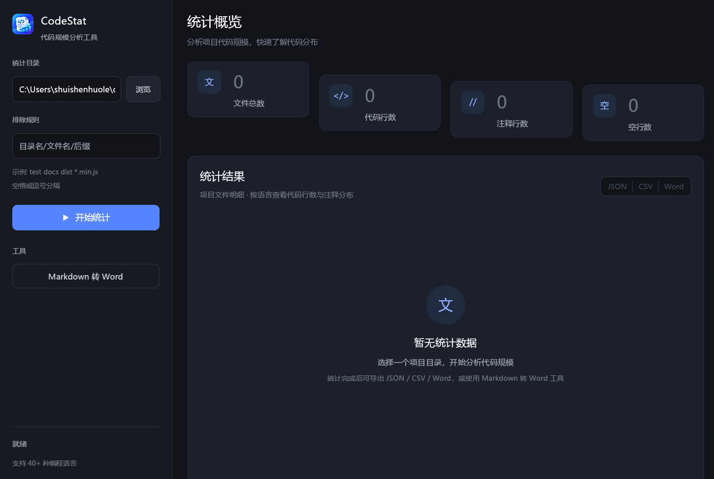

# CodeStat — 代码量统计工具

基于 **Rust + egui** 的桌面代码量统计工具。选择一个项目目录，即可按语言统计代码行 / 注释行 / 空行，支持 43 种编程语言，可导出 JSON / CSV / Word，并内置 Markdown 转 Word 工具。



## ✨ 特性

- **多语言识别**：支持 43 种编程语言与标记语言，含 Dockerfile / Makefile / CMakeLists.txt 等特殊文件名识别
- **行数细分**：区分代码行、注释行、空行，正确处理行注释与块注释（含 Python 文档字符串等语言特有语法）
- **灵活排除**：内置 25+ 常见排除目录（`node_modules`、`target`、`.git` 等），支持 `.codestatignore` 文件与界面输入自定义规则
- **三种导出**：JSON（含 `Total` 汇总项）、CSV、Word（A4 排版 + 页眉页脚页码 + 代码卡片，超出前后各 60 页自动截断）
- **Markdown 转 Word**：标题、列表、表格、引用、代码块、行内格式、本地图片与 Data URI 图片，套用统一 A4 文档样式
- **原生体验**：egui 深色主题界面、系统原生文件对话框、后台线程扫描不卡 UI
- **零运行时依赖**：图标编进二进制，中文字体加载系统自带字体（微软雅黑 / 等线 / 黑体），单文件即可分发

## 🚀 快速开始

环境要求：**Rust 1.85+**（edition 2024）

```bash
git clone git@github.com:shuishenhuole/codeanalyse.git
cd codeanalyse
cargo run
```

Linux 下需先安装 GTK3 / X11 开发库（Windows 与 macOS 无额外依赖）：

```bash
sudo apt-get install -y libgtk-3-dev libxkbcommon-dev libxkbcommon-x11-dev \
    libxcb-render0-dev libxcb-shape0-dev libxcb-xfixes0-dev libx11-dev pkg-config
```

## 📖 使用指南

### 1. 统计代码量

1. 在左侧「统计目录」中输入或点击「浏览」选择项目目录
2. 可选：在「排除规则」中填入要跳过的目录名 / 文件名 / 扩展名，用空格或逗号分隔（如 `test docs dist js`）
3. 点击「▶ 开始统计」，右侧显示统计概览与按语言明细

排除规则三层叠加：**内置默认排除** + 项目根目录 `.codestatignore`（每行一条，`#` 注释）+ **界面输入**。目录与文件按名称精确匹配，扩展名匹配时大小写不敏感（`js` 与 `.js` 等价）。

### 2. 导出结果

统计完成后，点击「统计结果」右上角的 **JSON / CSV / Word** 按钮选择保存位置即可。

JSON 输出为按代码行数降序的数组，末尾固定追加 `Total` 汇总项，方便脚本处理：

```json
[
  { "language": "Rust", "files": 18, "code": 3200, "comment": 410, "blank": 520, "total": 4130 },
  { "language": "Total", "files": 42, "code": 9800, "comment": 1200, "blank": 1800, "total": 12800 }
]
```

Word 导出包含标题页、统计概览表与逐文件代码正文；内容超过前后各 60 页时会省略中间部分并插入红色提示。

### 3. Markdown 转 Word

点击左侧「工具」区域 **Markdown 转 Word**，选择 `.md` / `.markdown` 文件后自动推导输出文件名（`{原名}.docx`）。支持标题、有序/无序列表、表格、引用、代码块、水平线、粗体/斜体/行内代码/链接，以及本地图片与 Data URI 图片（网络图片不自动下载，转为占位提示）。

## 🗂 项目结构

```
src/
├── main.rs            # 程序入口：窗口与图标配置
├── app.rs             # 应用状态：后台扫描线程、事件处理、toast 提示
├── theme.rs           # 深色主题、CJK 字体加载、公共控件样式
├── lib.rs             # 库入口（供集成测试使用）
├── core/              # 核心统计逻辑
│   ├── language.rs    #   43 种语言识别规则（扩展名 / 特殊文件名 → 注释语法）
│   ├── stats.rs       #   代码 / 注释 / 空行统计
│   └── scanner.rs     #   目录遍历与排除规则（默认排除 + .codestatignore + 界面输入）
├── docx.rs            # 轻量 OOXML 生成器（A4 页面、页眉页脚、表格、代码卡片、图片）
├── export/            # JSON / CSV / Word 导出
├── markdown.rs        # Markdown → Word 转换
└── ui/                # 界面模块：侧边栏、统计面板、Markdown 对话框
tests/                 # 集成测试（core / docx / export / markdown，共 16 个用例）
.github/workflows/     # 三平台发布工作流
```

## 🧪 开发

```bash
cargo test             # 运行 16 个集成测试
cargo clippy --all-targets   # 静态检查
cargo fmt              # 格式化
```

VS Code 用户：仓库已内置 `.vscode/` 配置，Code Runner（Ctrl+Alt+N）与任务均走 `cargo`，可直接 F5 调试（需 CodeLLDB 扩展）。

## 📦 发布

推送 `v*` 格式的 tag 会触发 GitHub Actions，自动构建并发布三平台产物：

| 平台 | 产物 |
| --- | --- |
| Windows x64 | `CodeStat-<tag>-windows-x64.zip` |
| Linux x64 | `CodeStat-<tag>-linux-x64.tar.gz` |
| macOS arm64 | `CodeStat-<tag>-macos-arm64.tar.gz` |

```bash
git tag v0.1.0
git push origin v0.1.0
```

## 📄 许可证

[MIT](LICENSE)
